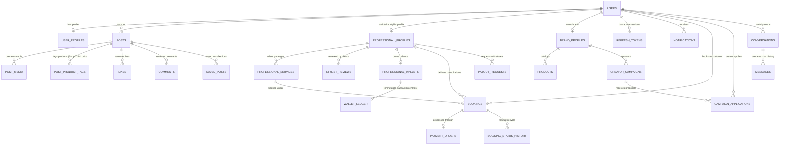

# DROBE — Entity-Relationship (ER) Diagram & Schema Architecture

This document formalizes the relational database architecture powering DROBE, covering all 10 business domains with UUID keys, strict foreign keys, indexing, and financial ledger integrity.

## Schema Domains

### 1. Identity & Access Management
- `users`: Core authentication identity, role enum (`enthusiast`, `stylist`, `creator`, `brand`, `store`, `admin`, `super_admin`), Argon2id password hash, status (`active`, `pending_verification`, `suspended`).
- `user_profiles`: Editorial metadata, username, display name, avatar, bio, location (City, State, Country), fashion interest array, follower/following/post counters.
- `refresh_tokens`: Cryptographic refresh tokens with expiry, rotation, and revocation flags.

### 2. Social Community & Shop This Look
- `posts`: Fashion looks, captions, styling notes, categories (`Old Money`, `Quiet Luxury`, `Wedding`, `Streetwear`, `Minimalist`), location, counters.
- `post_media`: Image and video assets with order index and aspect ratios.
- `post_product_tags`: Interactive coordinate pins (`pin_x`, `pin_y`) linking garments directly to brand catalogs and shopping URLs.
- `likes` & `comments`: Social engagement with unique constraints and nested replies.
- `saved_posts` & `collections`: User moodboards and private/public collections.

### 3. Professional Stylist Marketplace
- `professional_profiles`: Category, specializations, experience, multi-city operating footprint (`Kozhikode`, `Kochi`, `Bengaluru`, `Mumbai`), ratings, portfolios, verification status.
- `professional_services`: Service packages (e.g. Virtual Closet Audit, Bridal Trousseau, 1-on-1 Video Session), durations, base prices, advance payment requirements.
- `stylist_reviews`: Human client ratings and reviews linked to verified completed bookings.

### 4. Booking & Payment Engine
- `bookings`: Lifecycle states (`requested`, `accepted`, `confirmed`, `completed`, `cancelled`, `disputed`), service mode, financial amounts (total amount, advance amount, platform commission 20%, stylist payout 80%), Razorpay order and payment IDs.
- `booking_status_history`: Audit trail of every transition.
- `payment_orders`: Server-verified payment orders.
- `professional_wallets` & `wallet_ledger`: Immutable double-entry ledger for earnings, escrow credits, platform commission deductions, and payouts.

### 5. Brands & Creator Collaboration
- `brand_profiles`: Boutiques and designer labels, store hours, physical addresses, website links.
- `products`: Garment catalog, pricing, discount pricing, available sizes, colors, direct shopping destination URLs.
- `creator_campaigns`: Brand sponsorship campaigns with budgets in INR, deliverable specs, deadlines.
- `campaign_applications`: Creator pitches, quoted fees, and deliverable status.

### 6. Editorial Style Guides
- `style_guides`: Curated sartorial guides with color palettes, clothing pairings, stylist insider rules, and occasion suitability.
